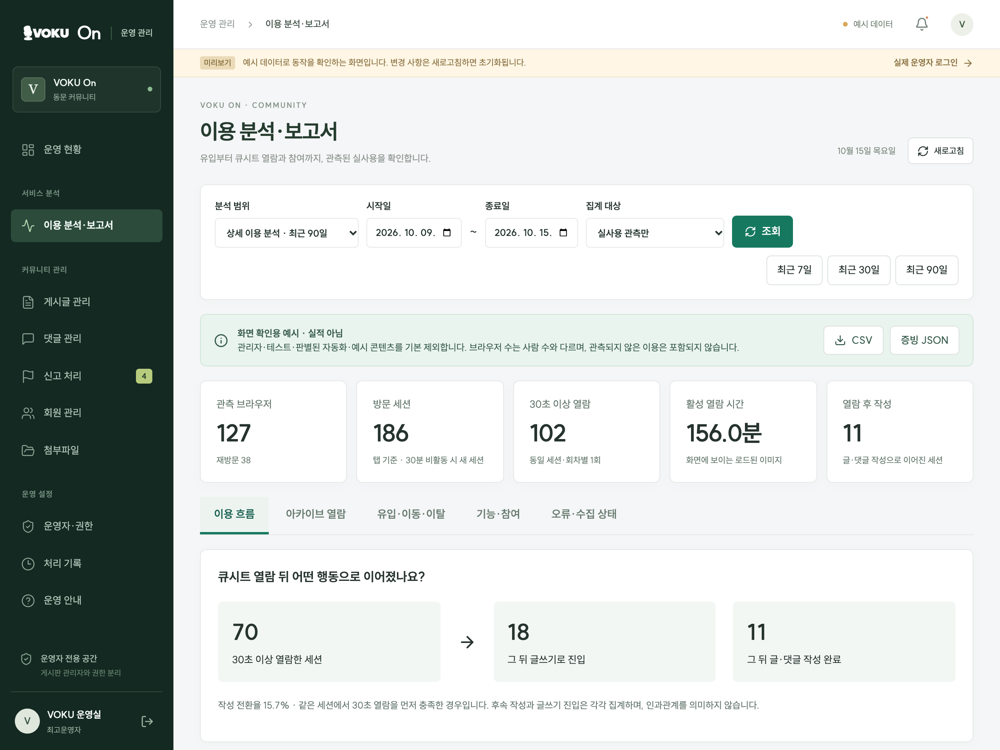
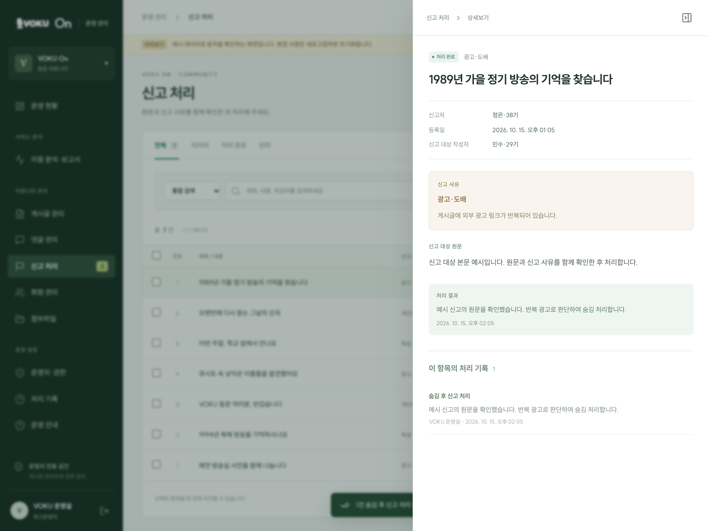

# VOKU On Operations

**The operations dashboard for VOKU On: moderation, separate staff access, and aggregate usage reporting.**

VOKU is a university student broadcasting station whose cue-sheet archive spans **32 years (1988–2019)**. VOKU On gives alumni a place to read those historic cue sheets and talk about them. This dashboard handles a different set of questions: who can manage the community, why something changed, and what the service's usage records actually show.

It is a desktop-oriented app and backend for an independently operated personal project. The interface is in Korean.



*Choose a reporting period and audience, then read the observed sequence from archive viewing to participation. All figures here are sample data, not evidence of live use; the preview notice remains visible. [View full size](docs/readme/usage-report.webp).*

[Try the sample dashboard](#try-the-sample-dashboard) · [Design decisions](#design-decisions) · [Access and roles](#access-and-roles) · [Related projects](#related-projects)

## Why a separate operations app?

Community participation and operations work are different responsibilities. VOKU On already had a board administrator. Adding a dashboard meant defining who could handle reports, manage operations access, and read usage reports without turning every administrator into the same all-purpose account.

The scope later expanded to usage reporting. Publishing the archive establishes that the material is available; understanding how it is explored and read requires observations over time. The dashboard provides a place to accumulate and explain those observations, while keeping identifiable test, staff, bot, and sample activity separate.

## Design decisions

### Share the database with separate authority

The apps work with the same posts and reports in Supabase. Operations accounts have dedicated identities, roles, and session storage. A community board administrator (게시판 관리자) does not automatically receive dashboard access, and an operations account does not become a community author.

The [security and operations guide](docs/security-and-operations.md) documents the backend checks of account identity, session, role, and MFA. The dashboard manages the running community; archive preparation belongs to the separate Workflow project.

### Keep the reason with the change

A report is a small sequence of decisions: inspect the reported content, choose a permitted action, enter a reason, and leave a record the next operator can understand.



*Review the result and the reason left with it. This sample report was handled in local preview mode; names, content, and processing records are sample data. [View full size](docs/readme/report-record.webp).*

The capture shows the record after a sample “hide and resolve” action. Mandatory reasons, stale-version checks, and batches of up to 50 items are enforced by the server functions described in the [operations guide](docs/security-and-operations.md#처리와-이력). The local preview demonstrates the reason and processing record; the guide covers backend authorization and concurrency rules.

The same dashboard supports post and comment searches, hiding and restoration, pinning existing posts, comment locking, and temporary restrictions on ordinary member accounts. Owners manage dedicated operations access.

### Make usage reports explainable

The report at the top exposes the reporting period, audience filter, metric definitions, and sample-data notice alongside the numbers. Opening an episode and observing a loaded page are different events. Recognized test and staff activity should remain distinguishable from ordinary use.

The dashboard and CSV/JSON exports provide aggregates. More detailed usage-path analysis is a separate, restricted backend procedure with a recorded purpose and scope. Dashboard roles do not receive that analysis permission. The [reporting limits](#what-the-reports-canand-cannotsay) below explain how to interpret the results.

AI coding agents helped implement these choices in stages: separate operations access, moderation actions with reasons, then usage reporting. Local database tests cover roles, conflicting changes, and batch rollback; browser checks use sample mode to exercise the operator's workflow. The [verification notes](docs/verification.md) keep those checks distinct, so a working sample screen is not presented as proof of backend authorization.

## Try the sample dashboard

Use **Node.js 24.13.0**, as specified in `.node-version`.

```sh
git clone https://github.com/NewTypeCola/VOKU-On-Operations.git
cd VOKU-On-Operations
npm ci
npm run dev
```

Open `http://127.0.0.1:5230/?preview=1`, or add **`?preview=1`** to the local URL printed by Vite.

Preview mode uses sample data and does not create a Supabase client, even when backend environment variables are present. Changes stay in memory and reset on refresh. Reports produced in preview mode are marked as samples, not evidence of live activity. No live operations account is needed to explore this mode.

## Access and roles

Live operations access requires a registered operations account, **Google sign-in**, and authenticator-app verification at **MFA assurance level 2 (AAL2)**. A publicly reachable login page does not provide access to operations data.

| Role | Korean UI label | Permission |
| --- | --- | --- |
| `owner` | 최고운영자 | Read permitted data, moderate content, and manage operations accounts and roles. |
| `operator` | 운영자 | Read permitted data and perform allowed moderation actions. |
| `viewer` | 조회 담당자 | Read permitted data and aggregate reports without making changes. |

Operations accounts use dedicated Google identities, separate from community accounts. Community board administrators (게시판 관리자) do not inherit these roles.

Server checks cover account status, verified email, role, session validity, and MFA. The system prevents self-modification of privileges and protects the last owner. Operations-account management records are restricted to owners. See [security and operations](docs/security-and-operations.md) for the rules and recovery procedures.

### Connect a live backend

```sh
cp .env.example .env.local
```

Set `VITE_SUPABASE_URL` and `VITE_SUPABASE_PUBLISHABLE_KEY` for the shared community database. Follow the security and operations guide for schema setup and account registration. Leave preview mode to use live data.

Only browser-safe configuration belongs in `VITE_*` variables. The publishable key does not grant operations privileges; private credentials must stay outside the browser bundle. For a new deployment, configure the frontend origin allowlist and Supabase redirects together. Arbitrary deployment-preview URLs are not automatically authorized for sign-in.

## Data and service boundaries

| Location | Responsibility |
| --- | --- |
| `VOKU-On/supabase/migrations/` | Community schema, storage, and community access policies. |
| `VOKU-On-Operations/supabase/migrations/` | Operations roles and actions, audit records, usage reporting, and restricted backend analysis. |
| `VOKU-On/functions/` | Cloudflare Pages Functions, including the usage collector. |
| `VOKU-On-Operations/tests/fixtures/community/` | Community schema fixtures for isolated local tests. |

Review the shared database's applied migration history before deployment. Test fixtures are not production migration instructions, and a frontend build does not apply database migrations. The collector's private ingestion key belongs on the VOKU On server, not in this dashboard's browser environment.

Member fields retain their meaning from VOKU On: **enrollment year (학번)** is a year, not a full student identification number; **membership cohort (기수)** is the member's cohort within VOKU. Access is limited to authorized roles.

## What the reports can—and cannot—say

Browser identifiers represent browser activity, not verified people. Observed page visibility and active time do not prove comprehension or completion. A community action after reading is an observed sequence, not proof that reading caused it. Missing historical usage records are not reconstructed from old cumulative counters.

CSV and JSON exports contain aggregate reports. Checksums help check snapshot consistency; they do not certify audience size or impact. The [analytics guide](docs/analytics.md) defines the metrics, exclusions, retention rules, and reporting limits.

Restricted backend analysis requires its purpose and scope to be committed before results can be read. Results use request-scoped aliases and expire after 10 minutes. Erasing a browser's retained details invalidates temporary results containing that browser. This is not a guarantee of complete anonymity, and the procedure does not constrain the database owner. Details belong in the [backend analysis guide](docs/backend-analysis.md), not in dashboard permissions.

Collection and browser controls are described on the [VOKU On privacy page](https://voku.pages.dev/privacy/). These features provide a way to build evidence of use; their existence is not itself a claim of adoption or increased engagement.

## Check, build, and deploy

```sh
npm run check
npm test
npm run build
npm run preview
```

The project uses **React, TypeScript, Vite, and Supabase**. Tests use **PGlite** to exercise migrations, permissions, moderation, reporting, and privacy behavior locally. The commands above are local checks; existing verification documents record the scope of earlier database, browser, and deployment checks separately.

| Cloudflare Pages setting | Value |
| --- | --- |
| Production branch | `main` |
| Build command | `npm ci && npm test && npm run build` |
| Output directory | `dist` |
| Node.js version | `24.13.0` |

`npm run preview` serves the built frontend on the same port as the development server. Run only one of them at a time. Frontend deployment, database migrations, and the collector configuration are separate steps.

## Related projects

| Project | Responsibility |
| --- | --- |
| [VOKU Archive dataset](https://huggingface.co/datasets/NewTypeCola/VOKU-Archive) | The prepared cue-sheet images, OCR, and token annotations. |
| [VOKU Archive Workflow](https://github.com/NewTypeCola/VOKU-Archive-Workflow) | Workflow, History, a three-episode execution demo, and a review web app documenting archive preparation. |
| [VOKU On](https://github.com/NewTypeCola/VOKU-On) | Archive browsing, continuous reading, and the alumni community. |
| **VOKU On Operations — this repository** | Moderation, separate operations access, and aggregate usage reporting. |

## Further reading

[Application structure](docs/structure.md) · [Security and operations](docs/security-and-operations.md) · [Analytics](docs/analytics.md) · [Restricted backend analysis](docs/backend-analysis.md)

[Initial verification](docs/verification.md) · [Analytics verification](docs/analytics-verification.md) · [Google sign-in verification](docs/google-login-verification.md) · [Backend analysis verification](docs/backend-analysis-verification.md) · [Dashboard references](docs/admin-dashboard-references.md)

Detailed implementation notes are currently in Korean. Bundled fonts retain their [SUIT font license](public/fonts/OFL.txt). Archive materials and Workflow documentation have separate rights notices in their respective projects.
